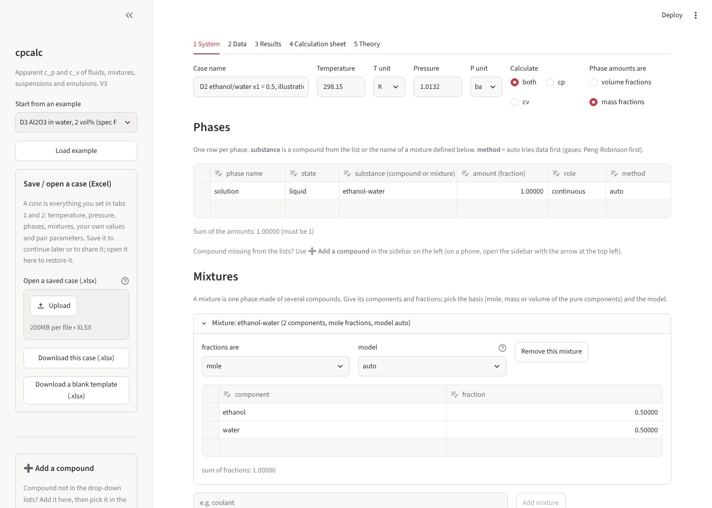
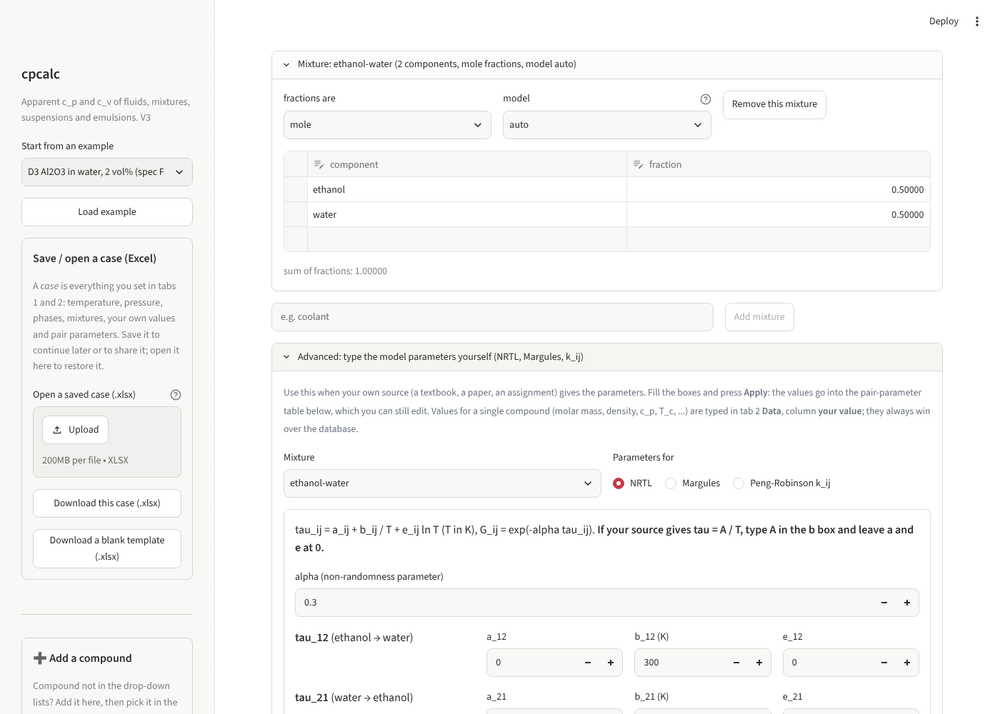

# cpcalc: apparent heat capacity of fluids, mixtures and multiphase samples

**cpcalc** calculates the *apparent* specific heat capacities **c_p** (constant pressure) and **c_v** (constant volume) of a sample. The sample can be a pure liquid, solid or gas, a mixture, or several phases together: a nanofluid, an emulsion, a slurry. It was written for the CL 202 Topic 5 course project.

You describe the sample in a web interface (or an Excel workbook), and the program:

1. finds c_p of every phase from data, or from a model when data are missing;
2. converts to c_v with the thermodynamic identity c_p − c_v = T α_V² / (ρ κ_T);
3. combines the phases into one apparent c_p and c_v;
4. shows every step with its equation, the numbers substituted and the result, and tells you how reliable the result is.



## Quick start

You need Python 3.10 or newer. In a terminal, inside the project folder:

```bash
python -m venv venv                  # 1. create a private environment (once)
venv\Scripts\activate                # 2. activate it   (Mac/Linux: source venv/bin/activate)
pip install -r requirements.txt      # 3. install the libraries (once)
python -m cpcalc ui                  # 4. start the app; it opens in your browser
```

The next time, only steps 2 and 4 are needed. **[SETUP.md](SETUP.md)** explains every step for Windows, Mac and Linux, what each command does, how to deploy the app online, and what to do when something goes wrong.

## Using the web interface

The app has five tabs and a sidebar.

| Tab | What you do there |
|---|---|
| **1 System** | Set temperature and pressure, choose c_p, c_v or both, and describe the **phases** (state, substance, amount). Define **mixtures** (components, fractions, model). Optionally set a sweep over temperature, phase amount or composition. |
| **2 Data** | See every property the calculation needs at your temperature, where it comes from, and its status. Type your own number in the **your value** column: *it always wins over the database*. Add your own (T, value) curves. |
| **3 Results** | c_p,app and c_v,app, the phase table, warnings, assumptions, the status, a sweep chart, and downloads (HTML calculation sheet, text, JSON). |
| **4 Calculation sheet** | The route taken for each phase and every step with its equation, typeset in LaTeX. |
| **5 Theory** | 14 short pages that explain the method from the start: a flow diagram, then c_p to c_v, liquids and solids, gases, mixtures (excess functions, Margules, NRTL, k_ij), combining phases, data and status, a model chooser and a symbol table. |

**Sidebar**

- **Start from an example**: 13 ready-made cases (`python -m cpcalc examples` lists them).
- **Save / open a case (Excel)**: *Download this case* saves everything in tabs 1 and 2 as an `.xlsx` workbook; *Open a saved case* restores it; *Download a blank template* gives an empty workbook with drop-down lists. Use it to continue later, share a setup, or edit many values in Excel.
- **➕ Add a compound**: for a compound that is not in the lists. *Find in thermo* looks it up by name, formula or CAS number and adds its data with sources. *Add as my own* adds the name and you type its data in tab 2.
- **Browse the database**: search the 192 built-in compounds.

### Typing your own model parameters (Advanced)

In tab 1, below the mixtures, the **Advanced** section lets you type the parameters of a mixture model yourself: choose the mixture, choose **NRTL**, **Margules** or **Peng-Robinson k_ij**, fill the boxes and press **Apply**. The values go into the pair-parameter table (which you can still edit), and the mixture's model is set for you.

Example: ethanol (1) + water (2) with NRTL parameters given as τ = A/T, with A₁₂ = 3.17 K, A₂₁ = 523.84 K and α = 0.30:

| Box | Value |
|---|---|
| alpha | 0.30 |
| b_12 (ethanol → water) | 3.17 |
| b_21 (water → ethanol) | 523.84 |
| all a and e boxes | 0 |

The panel then prints τ, G and the infinite-dilution activity coefficients as a check of your inputs (here γ₁^∞ = 5.86 and γ₂^∞ = 2.85 at 298.15 K). Values for a single compound (molar mass, density, c_p, T_c, ...) are typed in tab 2 in the *your value* column.



## Command line

Run these from the project folder with the environment active.

| What | Command |
|---|---|
| Web interface | `python -m cpcalc ui` |
| List the examples | `python -m cpcalc examples` |
| Run one example | `python -m cpcalc example D3 --explain` |
| Run every example | `python -m cpcalc example all` |
| Run your workbook | `python -m cpcalc run my_case.xlsx --explain --html sheet.html` |
| Make an Excel template | `python -m cpcalc template --out my_case.xlsx` |
| Run all tests | `python -m cpcalc test` |

In the browser, `http://localhost:8501/?example=D6` opens that example directly.

## How it works

```
describe the sample  ->  c_p of every phase  ->  c_v of every phase  ->  combine the phases  ->  result + status
 (T, P, phases)           liquid/solid: data (solid: Debye)             c_p: mass average
                          gas: Peng-Robinson / ideal gas                c_v: whole-sample identity
                          mixture: ideal + excess function
```

The models are **equations written in the code**, not separate libraries:

| Model | What it does here | Where |
|---|---|---|
| **Peng-Robinson** equation of state | departure functions for gases (and liquids if you choose it): C_p, C_v, density, α_V, κ_T | `pure.py` |
| **Debye** model | C_v of a solid from its Debye temperature θ_D | `pure.py` |
| **Ideal mixing** | mass-weighted average of the components (C_p^E = 0) | `mixtures.py` |
| **Margules** | excess Gibbs energy of a two-component liquid with three constants A, B, D, giving H^E and C_p^E | `mixtures.py` |
| **NRTL** | local-composition excess Gibbs energy with τ₁₂, τ₂₁ and α; H^E and C_p^E by differentiating with temperature | `mixtures.py` |
| **Peng-Robinson mixing, k_ij** | gas mixtures from the pure-gas constants and a binary interaction parameter | `mixtures.py` |

The Theory tab explains each of them with its equations, when it applies and where to type its inputs.

## Libraries

| Library | Used for | Needed? |
|---|---|---|
| **NumPy** | arrays and numerical work | yes |
| **SciPy** | the numerical integral of the Debye model (`scipy.integrate.quad`) | yes |
| **openpyxl** | reading and writing the Excel workbooks | yes |
| **pandas** | the editable tables in the web interface | yes (interface) |
| **Streamlit** (≥ 1.51) | the web interface | yes (interface) |
| **thermo** (with its companion **chemicals**) | *Find in thermo*: looks a compound up by name, formula or CAS number and gets T_c, P_c, ω, boiling point, M and so on | optional |
| **pytest**, **sympy** | the tests | development |
| **CoolProp** | accurate fluid properties, used to build `database.json` and to validate the results | development |

The calculation engine itself (`cpcalc/engine.py` and the modules it imports) needs only NumPy and SciPy.

## Project layout

```
cpcalc/
  engine.py        the calculation: run_case() does everything
  pure.py          pure-phase models: Peng-Robinson, Debye, ideal gas
  mixtures.py      fraction conversions, ideal mixing, Margules, NRTL, k_ij mixing
  sample.py        combining phases into the whole sample
  properties.py    finds each number: your value > your curve > database
  database.py      loads data/database.json (192 compounds)
  lookup.py        "Find in thermo"
  units.py         the only place where units are converted
  workbook.py      Excel / CSV  <->  case
  report.py        text and HTML calculation sheet     latex.py   LaTeX helpers
  theory.py        the Theory pages                     examples.py   the 13 examples
  app.py           the Streamlit web interface          cli.py     command line
  constants.py     property list, units, messages       errors.py  error handling
  data/database.json
docs/              screenshots
tests/             engine, consistency, examples, interface and I/O, V3 additions
validate/          comparison with CoolProp (error_table.txt)
tools/             build_database.py (rebuilds the database)
streamlit_app.py   launcher used for online deployment
```

## Database (192 compounds, temperature-dependent)

Built by `tools/build_database.py`. Every record names its source and kind.

- **About 130 fluids from CoolProp reference equations of state.** For each: liquid c_p, ρ, α_V and κ_T at 1 atm from the triple point to the normal boiling point; ideal-gas C_p; T_c, P_c, ω and M.
- **About 37 extra liquids from thermo/chemicals data methods** (alcohols, glycols, glycerol, acids, solvents; Zábranský, DIPPR/Perry, VDI and CRC). κ_T for these comes from the COSTALD estimate and is labelled *estimated*.
- **24 particle solids** (oxides, metals, SiC and others): c_p curves from NIST-JANAF, the NIST WebBook, Perry or CRC; density from CRC; α_V and κ_T near room temperature for Al2O3, Cu, Ag, Au, Al, Fe, Ni and Si.
- **Spec values**: the NIST-JANAF α-Al2O3 curve, and θ_D(Cu) = 343 K (marked unverified).

Data are never extrapolated. Outside a range the run stops and says which range exists, for example "water boils at 373.12 K at 1 atm".

## Tests

```bash
pip install -r requirements-dev.txt
python -m cpcalc test
```

| Suite | Tests | Covers |
|---|---|---|
| Engine | 25 | units, lookup order, ranges, fractions, mixture bases, errors, warnings, status |
| Consistency | 18 | the spec identities and limits |
| Examples | 25 | every example, with the spec targets for D1–D9 |
| Interface and I/O | 21 | workbook round trips, reports, command line, database integrity, the web app |
| V3 additions | 11 | the NRTL check values, the equations printed on the theory pages, the Advanced section, the save/open buttons |
| Validation | 32 | comparison with CoolProp; skipped if CoolProp is not installed |

## Design choices and limits

- **Evidence kinds.** Evaluated data (CoolProp reference equations, JANAF, Zábranský, DIPPR, CRC) count as *experimental*, so a run on database data can be "calculated". Estimation methods count as *estimated*, and placeholders as *illustrative*. A result is only as strong as its weakest input.
- **Assumptions are always listed and lower the status.** Examples: C_p^E = 0 for an ideal mixture, V^E = 0 for the mixture density, α_V and κ_T, k_ij = 0 when blank.
- **Method order when set to auto:** liquid: data only (Peng-Robinson only if you choose it, because its liquid caloric errors reach about 26 %); solid: data, then Debye; gas: Peng-Robinson, then ideal gas.
- **Liquids at another pressure** use the 1 atm database data; a note is shown above 6 bar.
- **Mixture models are for two components** (NRTL, Margules). Gas mixtures can have more.
- **NRTL parameters fitted to vapour-liquid equilibrium** describe the activity coefficients well, but the heat-capacity correction comes from their temperature derivative and can be poor. Prefer parameters fitted to H^E or C_p^E data.
- **Not included:** the measured V^E and H^E of a mixture as Redlich-Kister series, pressure sweeps, extrapolation of data.

## Deploying online

The app can be hosted free on Streamlit Community Cloud so that anyone can use it from a link without installing anything. See the last section of [SETUP.md](SETUP.md).

## Version history

- **V3**: Advanced section to type NRTL, Margules and k_ij parameters; clearer *Save / open a case* box with a blank template; *Add a compound* highlighted; Theory rewritten as a guided flow (14 pages with a diagram, separate Margules, NRTL and k_ij pages, model chooser and symbol table); README and SETUP guide. The calculations themselves are unchanged (only the version number and a display helper for the NRTL panel were added).
- **V2**: web interface, database of 192 compounds with "add your own", calculation sheet in LaTeX, theory pages; a smaller engine and workbook (six sheets) than V1.
- **V1**: the engine and Excel workbook that follow the course specification (Eqs. 1–23).
